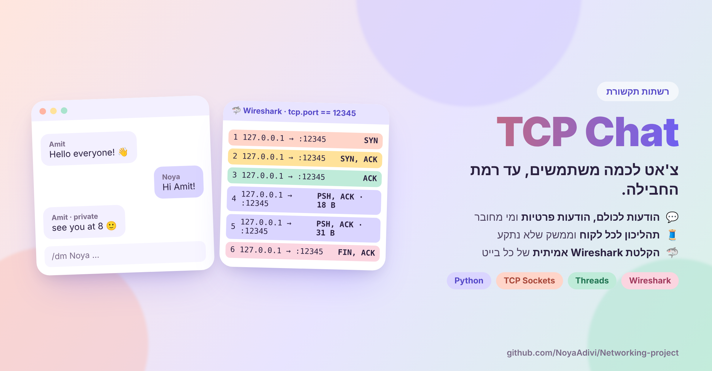
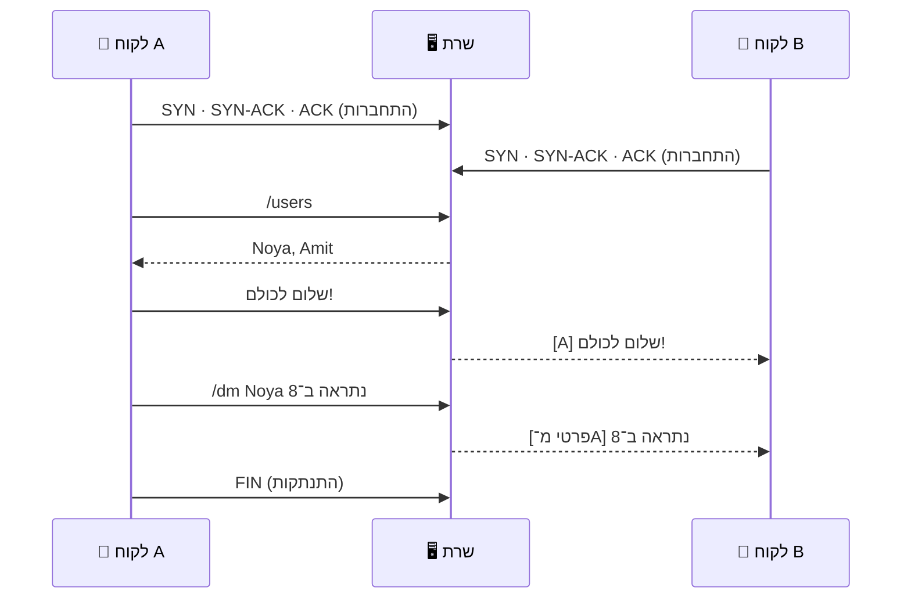

<div dir="rtl">

<p align="center">
  <a href="https://github.com/NoyaAdivi/Networking-project"></a>
</p>

<p align="center"><a href="README.md"></a></p>

<p align="center">
  <a href="Summary_Report.pdf"></a>
  <a href="packets.pcapng"></a>
  <a href="#run-it"></a>
</p>

<p align="center">
  <a href="LICENSE"></a>
  <a href="https://github.com/NoyaAdivi/Networking-project/commits/main"></a>
  <a href="https://github.com/NoyaAdivi/Networking-project"></a>
  <a href="https://github.com/NoyaAdivi/Networking-project"></a>
</p>

<h3 align="center">צ'אט שרת ולקוח אמיתי, והוכחה לכל בייט שעובר ברשת.</h3>

<p align="center">
  שרת TCP ולקוחות עם ממשק גרפי שמדברים בזמן אמת, עם הודעות פרטיות ורשימת מחוברים,<br>ועוד <b>הקלטת Wireshark</b> שמראה את לחיצת היד, את התוכן ואת הסגירה. פרויקט בקורס רשתות תקשורת.
</p>

<table align="center">
  <tr>
    <td align="center" width="25%"><a href="#run-it"><b>🔌 TCP</b></a><br><sub>פורט 12345</sub></td>
    <td align="center" width="25%"><a href="#how-it-works"><b>👥 כמה</b></a><br><sub>לקוחות במקביל</sub></td>
    <td align="center" width="25%"><a href="#how-it-works"><b>🧵 1</b></a><br><sub>תהליכון לכל לקוח</sub></td>
    <td align="center" width="25%"><a href="packets.pcapng"><b>🦈 .pcapng</b></a><br><sub>הקלטת תעבורה אמיתית</sub></td>
  </tr>
</table>

<p align="center">
  <a href="https://github.com/NoyaAdivi/Networking-project"></a>
</p>

<a name="highlights"></a>
<p align="center"><a href="#how-it-works"></a></p>

<table>
  <tr valign="top">
    <td width="33%"><p><b>💬 צ'אט מלא</b></p><ul><li><b>הודעה לכולם</b> בבת אחת</li><li><b>הודעות פרטיות</b> עם <code>/dm</code></li><li><b>מי מחובר</b> עם <code>/users</code></li></ul></td>
    <td width="33%"><p><b>🧵 אסינכרוני מההתחלה</b></p><ul><li><b>שרת:</b> תהליכון נפרד לכל לקוח</li><li><b>לקוח:</b> קבלת ההודעות רצה ברקע</li><li><b>הממשק לא נתקע</b> כשמגיעות הודעות</li></ul></td>
    <td width="33%"><p><b>🦈 רואים את זה ברשת</b></p><ul><li><b>לחיצת יד משולשת</b> וסגירה מסודרת</li><li><b>מספרי רצף ו־ACK</b> בהקלטה אמיתית</li><li><b>מחברת עם הסברים</b> לניתוח TCP/IP</li></ul></td>
  </tr>
</table>

<a name="how-it-works"></a>
<p align="center"><a href="#tech-stack"></a></p>



| פקודה | מה היא עושה |
|---|---|
| `/users` | מציגה מי מחובר |
| `/dm <username> <message>` | שולחת הודעה פרטית |
| טקסט חופשי | נשלח לכולם |

> [!NOTE]
> הכול רץ בזיכרון, אין צורך במסד נתונים.

<a name="tech-stack"></a>
<p align="center"><a href="#run-it"></a></p>

<p align="center">
  <a href="https://www.python.org"></a>
  <a href="https://docs.python.org/3/library/socket.html"></a>
  <a href="https://docs.python.org/3/library/threading.html"></a>
  <a href="https://docs.python.org/3/library/tkinter.html"></a>
  <a href="https://www.wireshark.org"></a>
  <a href="https://jupyter.org"></a>
</p>

<a name="run-it"></a>
<p align="center"><a href="#contact"></a></p>

צריך **Python 3** (בלי חבילות נוספות) ואת [Wireshark](https://www.wireshark.org) בשביל הניתוח.

1. **מפעילים את השרת** (מאזין לפורט 12345):
   ```bash
   python3 server.py
   ```
2. **מפעילים לקוח** בכל חלון טרמינל נוסף:
   ```bash
   python3 client_gui.py
   ```
3. בחלון: בוחרים שם משתמש ייחודי, כתובת `127.0.0.1`, פורט `12345`, ולוחצים **Connect**.

**🦈 להקליט:** על ממשק ה־**Loopback**, עם הסינון `tcp.port == 12345` (או `ip.addr == 127.0.0.1 && tcp.port == 12345`).

<details>
<summary><b>📂 הקבצים</b></summary>

| קובץ | מה הוא |
|---|---|
| [`server.py`](server.py) | שרת TCP שמנהל חיבורים ומעביר הודעות |
| [`client_gui.py`](client_gui.py) | לקוח עם ממשק גרפי |
| [`Summary_Report.pdf`](Summary_Report.pdf) | סיכום מלא של הפרויקט והארכיטקטורה |
| [`packets.pcapng`](packets.pcapng) | הקלטת Wireshark של התעבורה |
| [`group06_ttp_chat_input.csv`](group06_ttp_chat_input.csv) | נתוני הקלט של הצ'אט |
| [`raw_tcp_ip_notebook_fallback_annotated-v1.ipynb`](raw_tcp_ip_notebook_fallback_annotated-v1.ipynb) | מחברת עם ניתוח TCP/IP מוסבר |
</details>

<sub>🤖 נעזרנו בכלי AI רק ללמידה, לתכנון ולתיעוד. את כל הקוד בדקנו, הבנו והתאמנו בעצמנו.</sub>

<a name="contact"></a>
<p align="center"><a href="https://www.linkedin.com/in/noya-adivi/"></a></p>

<p align="center">
  <a href="https://github.com/NoyaAdivi/Networking-project"></a>
  <a href="https://www.linkedin.com/in/noya-adivi/"></a>
  <a href="https://noyaadivi.github.io/noya-website"></a>
  <a href="https://github.com/NoyaAdivi"></a>
</p>

</div>
