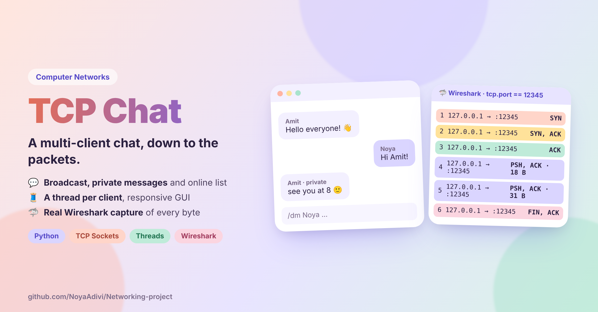
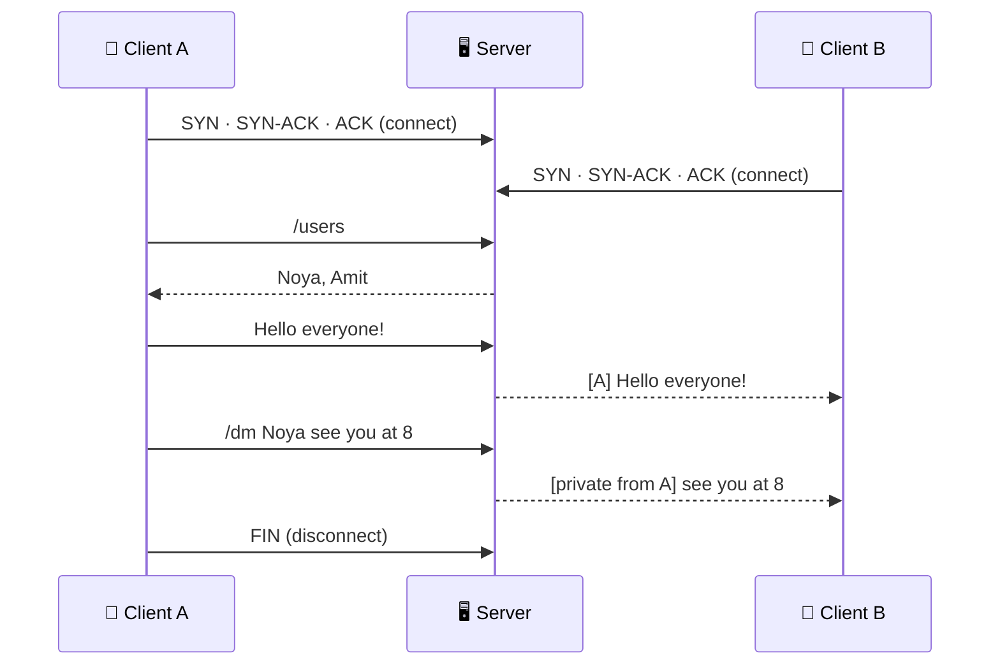

<p align="center">
  <a href="https://github.com/NoyaAdivi/Networking-project"></a>
</p>

<p align="center"><a href="README.he.md"></a></p>

<p align="center">
  <a href="Summary_Report.pdf"></a>
  <a href="packets.pcapng"></a>
  <a href="#run-it"></a>
</p>

<p align="center">
  <a href="LICENSE"></a>
  <a href="https://github.com/NoyaAdivi/Networking-project/commits/main"></a>
  <a href="https://github.com/NoyaAdivi/Networking-project"></a>
  <a href="https://github.com/NoyaAdivi/Networking-project"></a>
</p>

<h3 align="center">A real client-server chat, and proof of every byte on the wire.</h3>

<p align="center">
  A TCP server and GUI clients that chat in real time, with private messages and a live user list,<br>plus a <b>Wireshark capture</b> that shows the handshake, the payloads and the goodbye. Computer Networks course project.
</p>

<table align="center">
  <tr>
    <td align="center" width="25%"><a href="#run-it"><b>🔌 TCP</b></a><br><sub>port 12345</sub></td>
    <td align="center" width="25%"><a href="#how-it-works"><b>👥 Multi</b></a><br><sub>clients at once</sub></td>
    <td align="center" width="25%"><a href="#how-it-works"><b>🧵 1</b></a><br><sub>thread per client</sub></td>
    <td align="center" width="25%"><a href="packets.pcapng"><b>🦈 .pcapng</b></a><br><sub>real traffic capture</sub></td>
  </tr>
</table>

<p align="center">
  <a href="https://github.com/NoyaAdivi/Networking-project"></a>
</p>

<a name="highlights"></a>
<p align="center"><a href="server.py"></a></p>

<table>
  <tr valign="top">
    <td width="33%"><p><b>💬 A complete chat</b></p><ul><li><b>Broadcast</b> messages to everyone</li><li><b>Private messages</b> with <code>/dm</code></li><li><b>Who's online</b> with <code>/users</code></li></ul></td>
    <td width="33%"><p><b>🧵 Asynchronous by design</b></p><ul><li><b>Server:</b> a separate thread for each client</li><li><b>Client:</b> receiving runs in the background</li><li><b>GUI stays responsive</b> while messages arrive</li></ul></td>
    <td width="33%"><p><b>🦈 Seen on the wire</b></p><ul><li><b>Three-way handshake</b> and graceful close</li><li><b>Sequence numbers and ACKs</b> in a real capture</li><li><b>Annotated notebook</b> of the TCP/IP analysis</li></ul></td>
  </tr>
</table>

<a name="how-it-works"></a>
<p align="center"><a href="Summary_Report.pdf"></a></p>



| Command | What it does |
|---|---|
| `/users` | Show connected users |
| `/dm <username> <message>` | Send a private message |
| free text | Send to everyone |

> [!NOTE]
> Everything runs in memory. No database is needed.

<a name="tech-stack"></a>
<p align="center"><a href="https://docs.python.org/3/library/socket.html"></a></p>

<p align="center">
  <a href="https://www.python.org"></a>
  <a href="https://docs.python.org/3/library/socket.html"></a>
  <a href="https://docs.python.org/3/library/threading.html"></a>
  <a href="https://docs.python.org/3/library/tkinter.html"></a>
  <a href="https://www.wireshark.org"></a>
  <a href="https://jupyter.org"></a>
</p>

<a name="run-it"></a>
<p align="center"><a href="client_gui.py"></a></p>

Requires **Python 3** (no extra packages) and [Wireshark](https://www.wireshark.org) for the analysis.

1. **Start the server** (listens on TCP port 12345):
   ```bash
   python3 server.py
   ```
2. **Start a client** in each extra terminal:
   ```bash
   python3 client_gui.py
   ```
3. In the window: pick a unique username, host `127.0.0.1`, port `12345`, and click **Connect**.

**🦈 Capture it:** on the **Loopback** interface, filter with `tcp.port == 12345` (or `ip.addr == 127.0.0.1 && tcp.port == 12345`).

<details>
<summary><b>📂 Files</b></summary>

| File | What it is |
|---|---|
| [`server.py`](server.py) | TCP server that manages connections and routes messages |
| [`client_gui.py`](client_gui.py) | GUI client |
| [`Summary_Report.pdf`](Summary_Report.pdf) | Full project summary and architecture |
| [`packets.pcapng`](packets.pcapng) | Wireshark capture of the traffic |
| [`group06_ttp_chat_input.csv`](group06_ttp_chat_input.csv) | Chat input data |
| [`raw_tcp_ip_notebook_fallback_annotated-v1.ipynb`](raw_tcp_ip_notebook_fallback_annotated-v1.ipynb) | Annotated TCP/IP analysis notebook |
</details>

<sub>🤖 AI tools were used only to support learning, planning and documentation. All code was reviewed, understood and adapted by the authors.</sub>

<a name="contact"></a>
<p align="center"><a href="https://www.linkedin.com/in/noya-adivi/"></a></p>

<p align="center">
  <a href="https://github.com/NoyaAdivi/Networking-project"></a>
  <a href="https://www.linkedin.com/in/noya-adivi/"></a>
  <a href="https://noyaadivi.github.io/noya-website"></a>
  <a href="https://github.com/NoyaAdivi"></a>
</p>
